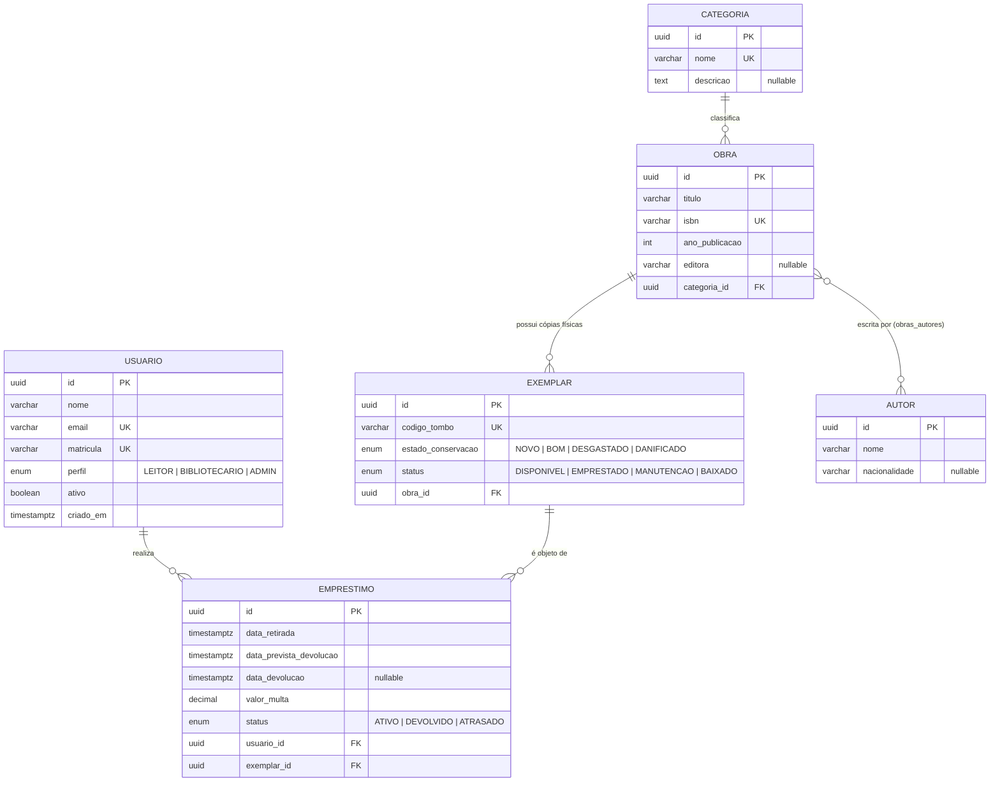

# Modelo de Dados — BiblioCom

Este documento descreve a evolução da modelagem de domínio do sistema **BiblioCom**, contemplando as entidades, os relacionamentos, as políticas de integridade referencial (`onDelete`) e as restrições aplicadas no banco de dados.

---

## 1. Diagrama Entidade-Relacionamento (ER)



---

## 2. Evolução do Modelo (Antes × Depois)

| Aspecto | Antes (Modelo Inicial) | Depois (Modelo de Domínio Atualizado) | Por que mudou? |
| :--- | :--- | :--- | :--- |
| **Persistência e Estrutura** | Lista fixa em memória no `ObrasService` com apenas 3 objetos (`id`, `titulo`, `autor`). | 6 entidades persistentes mapeadas com TypeORM (`Usuario`, `Obra`, `Autor`, `Categoria`, `Exemplar`, `Emprestimo`). | Sustentar todas as histórias *Must* (catalogação, controle de acervo físico e circulação de empréstimos). |
| **Identificadores** | IDs numéricos sequenciais simples (`1`, `2`, `3`). | Chaves primárias do tipo `uuid` geradas automaticamente. | Evitar enumeração previsível de registros em URLs públicas da API (`/api/obras/:id`). |
| **Autores** | Campo de texto simples dentro da obra (`autor: string`). | Entidade `Autor` separada ligada a `Obra` por relação **N-N** (`@ManyToMany` + `@JoinTable` `obras_autores`). | Uma obra pode ter múltiplos autores e um autor escreve várias obras; evita repetição e erros de digitação. |
| **Categorização** | Inexistente no objeto inicial. | Entidade `Categoria` ligada a `Obra` por relação **1-N** (`@ManyToOne` / `@OneToMany`). | Padronizar gêneros/assuntos do acervo e permitir filtros consistentes sem texto livre duplicado. |
| **Obra × Cópia Física** | Misturava o título bibliográfico com a disponibilidade do livro. | Separação entre `Obra` (dados catalográficos) e `Exemplar` (unidade física com `codigo_tombo` e `status`). | Uma mesma obra possui vários exemplares físicos na estante, cada um com estado de conservação e disponibilidade próprios. |
| **Empréstimos** | Inexistente. | Entidade associativa `Emprestimo` entre `Usuario` e `Exemplar` (duas relações **1-N**). | A relação entre usuário e exemplar possui atributos próprios do evento (`data_retirada`, `data_prevista_devolucao`, `data_devolucao`, `valor_multa`, `status`). |

---

## 3. Chaves Estrangeiras e Regras de Exclusão (`onDelete`)

| Tabela Origem (FK) | Tabela Destino (PK) | Relação | `onDelete` | Justificativa de Negócio |
| :--- | :--- | :--- | :--- | :--- |
| `obras.categoria_id` | `categorias.id` | `N:1` | `RESTRICT` | Impede excluir uma categoria enquanto houver obras catalogadas nela, evitando livros órfãos sem classificação no acervo. |
| `exemplares.obra_id` | `obras.id` | `N:1` | `RESTRICT` | Impede apagar o registro bibliográfico de uma obra se ainda existirem exemplares físicos vinculados no patrimônio da biblioteca. |
| `emprestimos.usuario_id` | `usuarios.id` | `N:1` | `RESTRICT` | Preserva o histórico de circulação, auditoria e eventuais pendências financeiras (`valor_multa`); usuários desligados devem ser inativados (`ativo = false`), nunca excluídos com histórico. |
| `emprestimos.exemplar_id` | `exemplares.id` | `N:1` | `RESTRICT` | Mantém a rastreabilidade completa de quem retirou cada exemplar físico ao longo do tempo, impedindo perda de histórico patrimonial. |
| `obras_autores.obra_id` / `autor_id` | `obras.id` / `autores.id` | `N:N` | `CASCADE` (padrão `@JoinTable`) | Remove apenas o vínculo associativo na tabela de junção caso a associação seja desfeita, sem apagar os registros principais de `Obra` ou `Autor`. |

---

## 4. Restrições e Índices no Banco de Dados

* **`obras.isbn` (`UNIQUE`):** Garante que o código ISBN internacional não seja duplicado no catálogo bibliográfico, evitando cadastros redundantes da mesma edição.
* **`@Index(['titulo', 'editora', 'anoPublicacao'], { unique: true })` em `Obra`:** Protege contra o cadastro duplicado de uma mesma edição (mesmo título, editora e ano) caso o ISBN seja informado com formatação divergente.
* **`exemplares.codigo_tombo` (`UNIQUE`):** Assegura que cada etiqueta patrimonial física da biblioteca identifique exclusivamente um único exemplar na estante.
* **`usuarios.email` e `usuarios.matricula` (`UNIQUE`):** Garante unicidade no login e impede que um mesmo estudante ou servidor crie múltiplas contas para burlar limites de empréstimos simultâneos.
* **`categorias.nome` (`UNIQUE`):** Evita categorias duplicadas com o mesmo nome (ex.: duas categorias "Romance"), mantendo a integridade dos filtros de busca.
* **`@Index(['usuario', 'exemplar', 'status'])` em `Emprestimo`:** Otimiza consultas frequentes de validação de regras de negócio (verificar se um usuário já possui empréstimos ativos ou atrasados) e rastreabilidade de circulação.
*

---

## 5. Verificação

### 5.1 Execução das migrações no banco vazio (`npm run migration:run`)

Ao executar `npm run migration:run` sobre o banco vazio `bibliocom` (com `synchronize: false`), o TypeORM criou a tabela de controle `migrations` e aplicou todas as tabelas, enums, chaves estrangeiras (`ON DELETE RESTRICT`) e índices compostos sem erros:

```text
query: SELECT * FROM current_schema()
query: CREATE TABLE "migrations" ("id" SERIAL NOT NULL, "timestamp" bigint NOT NULL, "name" character varying NOT NULL, CONSTRAINT "PK_8c82d7f526340ab734260ea46be" PRIMARY KEY ("id"))
query: SELECT * FROM "migrations" "migrations" ORDER BY "id" DESC
0 migrations are already loaded in the database.
1 migrations were found in the source code.
1 migrations are new migrations must be executed.
query: START TRANSACTION
query: CREATE TYPE "public"."usuarios_perfil_enum" AS ENUM('LEITOR', 'BIBLIOTECARIO', 'ADMIN')
query: CREATE TABLE "usuarios" (...)
query: CREATE TABLE "categorias" (...)
query: CREATE TABLE "autores" (...)
query: CREATE TABLE "obras" (...)
query: CREATE TABLE "exemplares" (...)
query: CREATE TABLE "emprestimos" (...)
query: CREATE TABLE "obras_autores" (...)
query: INSERT INTO "migrations"("timestamp", "name") VALUES (\$1, \$2) -- PARAMETERS: [..., "CriarTabelasIniciaisBiblioCom..."]
Migration CriarTabelasIniciaisBiblioCom has been executed successfully.
query: COMMIT
```

*(A reversão com `npm run migration:revert` também foi validada, removendo as tabelas na ordem inversa sem erros).*

### 5.2 Contagem de consultas na listagem paginada (`GET /api/obras`)

Com `logging: true` habilitado no TypeORM, a chamada paginada `GET /api/obras?page=1&limit=10` dispara exatamente **3 consultas SQL** fixas (independentemente da quantidade de obras retornadas), eliminando o problema de **N+1**:

1. **Consulta de contagem (`COUNT`):** Calcula o total de obras para os metadados de paginação.
2. **Consulta paginada de IDs (`SELECT DISTINCT ... LIMIT 10 OFFSET 0`):** Garante a paginação exata sem distorção pelos `JOIN`s das coleções.
3. **Consulta única com `LEFT JOIN`:** Carrega todas as obras da página junto com `categoria`, `autores` (via `obras_autores`) e `exemplares` em uma única ida ao banco.

### 5.3 Demonstração de violação de restrição (`ON DELETE RESTRICT` → HTTP `409 Conflict`)

Tentativa de excluir uma obra que possui exemplares físicos vinculados no acervo:

**Requisição (`curl`):**
```bash
curl.exe -i -X DELETE "http://localhost:3000/api/obras/aafd9af9-5ea3-413e-bfb2-849037f2936f"
```

**Resposta da API (tratada pelo `TypeOrmExceptionFilter` com status `409`):**
```http
HTTP/1.1 409 Conflict
Content-Type: application/json; charset=utf-8

{
  "statusCode": 409,
  "erro": "Violação de integridade referencial (RESTRICT)",
  "mensagem": "Operação bloqueada porque existem registros dependentes vinculados a este item.",
  "detalhe": "Chave (id)=(aafd9af9-5ea3-413e-bfb2-849037f2936f) ainda é referenciada pela tabela \"exemplares\"."
}
```